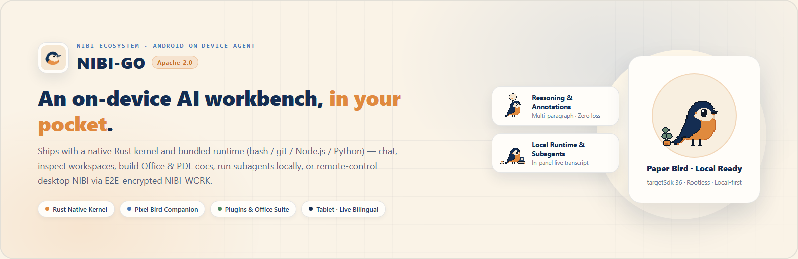
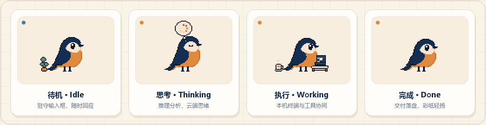
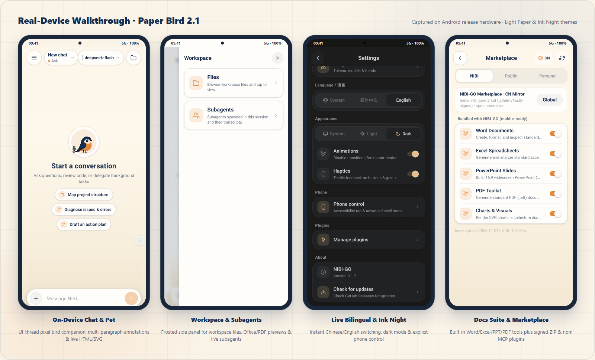
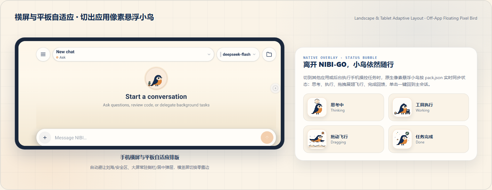

# NIBI-GO

<div align="center">
  

  <p>
    <a href="README.md">简体中文</a> ·
    <strong>English</strong> ·
    <a href="https://nibistudio.cn">Website</a> ·
    <a href="https://github.com/Ebonyhtx/nibi-go-market">Official Plugin Market</a> ·
    <a href="docs/README.md">Docs &amp; ADRs</a>
  </p>
</div>

**NIBI-GO** is the **Android mobile client** of the NIBI ecosystem. It packs a native Rust kernel, bundled command-line runtimes, a local workspace explorer, subagents, an Office/PDF document suite, and a cryptographically signed plugin ecosystem into your phone — so real engineering and document work continues away from your desk.

- **NIBI-GO (default app body)**: an on-device Android AI agent workbench — rootless, PRoot-free, local-first, with an independent mobile plugin ecosystem.
- **NIBI-WORK (built-in remote entry)**: one tap from the drawer to connect to desktop [NIBI](https://github.com/Ebonyhtx/nibi-client) over an end-to-end encrypted Relay V2 channel to monitor long-running tasks, answer prompts, and approve actions.

---

## Paper Bird Companion · Live Agent States at a Glance

Both the in-app pixel companion and the off-app floating overlay bird share a single `64×64` sprite sheet source (with matched Light Paper and Ink Night palettes). Driven directly on the UI thread with zero React re-renders during steady loops, the bird reflects every state — idle, thinking, working, carrying queued annotations, flying while dragged, and done.

<div align="center">
  
</div>

---

## Real-Device Walkthrough

<div align="center">
  
</div>

<br />

<div align="center">
  
</div>

---

## Key Capabilities

| Area | What you can do |
|---|---|
| **On-Device Rust Kernel & Bundled Runtime** | Runs self-built `libnibi.so` in-process (targetSdk 36, rootless) alongside bundled `bash`, `busybox`, `git`, `Node.js`, `Python`, `ripgrep`, and `jq` for real local workspace inspection and command execution. |
| **Readable Message Flow & Interactive Previews** | Streaming Markdown, code blocks, interactive HTML/SVG artifact cards with fullscreen preview, plus multi-paragraph / custom-trim annotations that preserve drafts if sending fails. |
| **Workspace Panel & In-Panel Subagents** | Center-swipe frosted-glass side panels for browsing workspace files, clean native preview of `docx / xlsx / pptx / pdf / md / html / images`, and live read-only subagent transcripts without leaving your main thread. |
| **Pixel Companion & Floating Status Bird** | Skia nearest-neighbor rendering on the UI thread (auto-paused in background); when you leave NIBI-GO or run phone tasks, the native `StatusBubble` pixel bird floats alongside you, flaps when dragged, and brings you right back on tap. |
| **Office Suite & Signed Plugin Market** | Ships with built-in Word / Excel / PowerPoint / PDF and Charts plugins; connects to [nibi-go-market](https://github.com/Ebonyhtx/nibi-go-market) for Ed25519-signed standard ZIP plugins and pure-JS npm MCP servers with automatic env-var detection and CN/Global mirror switching. |
| **Landscape, Tablet & Live Bilingual UI** | Material 3 adaptive breakpoints (safe-area aware phone landscape, persistent tablet sidebar/rail, centered wide sheets); real-time Simplified Chinese / English switching and Light Paper / Ink Night dark themes. |
| **NIBI-WORK Desktop Remote Control** | QR pairing with desktop NIBI over Relay V2 E2E encryption, foreground keep-alive service, and push notifications for approvals and completed tasks. |
| **Opt-in Phone Control (Dual Explicit Toggles)** | Off by default; enable Accessibility screen-read/tap (Toggle 1) and Shizuku advanced shell mode (Toggle 2) independently with explicit approval prompts. |

---

## Product Principles

- **Local-first**: conversations, workspaces, per-project memory, and provider configs stay on your device by default; remote control and account login are always explicit actions.
- **Inspectable outcomes**: tool calls, file changes, subagent logs, and generated documents can all be inspected directly instead of trusting a summary alone.
- **Explicit capability boundaries**: shell/runtime tools, phone automation, and third-party plugins require explicit opt-in; provider API keys remain in the kernel/keystore and never leak into child-process environments.
- **Verifiable distribution**: the official plugin index is Ed25519-signed, every ZIP and npm MCP package is verified by `sha256` / SRI digest, and release APKs verify against the release signing certificate fingerprint.

---

## Plugin Ecosystem & Security Note

The official plugin marketplace lives in [nibi-go-market](https://github.com/Ebonyhtx/nibi-go-market). The client accepts only the Ed25519-signed official index and verifies every package digest before installation. Third-party authors submit via pull request; see [CONTRIBUTING.md](https://github.com/Ebonyhtx/nibi-go-market/blob/main/CONTRIBUTING.md).

> Plugins are **executable code**: installing a third-party plugin runs software provided by its author on your device. Automated static scanning and human review reduce risk but are not an absolute guarantee — install only entries you trust. See [`docs/design/market-index.md`](docs/design/market-index.md) for signature verification and anti-rollback details.

---

## Open-Source Scope & Repository Layout

This repository contains all buildable public source code for NIBI-GO. Release signing keys, operator services, and internal engineering checklists are not kept here (see [SECURITY.md](SECURITY.md)).

| Directory | Responsibility |
|---|---|
| `app/` | Expo SDK 58 / React Native 0.88 application (`src/app/` expo-router screens, `src/i18n/` live bilingual engine) |
| `app/modules/kernel-host` | Kernel host: Expo native module, thin C JNI layer, and dedicated `:kernel` Service |
| `app/modules/nibi-phone` | Phone native module: floating pixel bird bubble (`StatusBubble.kt`), Accessibility bridge, Shizuku adapter |
| `app/modules/nibi-keepalive` | Foreground keep-alive service for background tasks and remote sessions |
| `app/modules/nibi-updater` | In-app APK installer (FileProvider + PackageInstaller + SHA-256 check) |
| `kernel/` | Maintained Android kernel fork (Rust workspace building 16 KB-aligned `libnibi.so` and `nibi-rs`) |
| `packages/kernel-session` | On-device session client: snapshot/delta projection, read-only subagent feeds, tool row derivation |
| `packages/relay-client` | Relay V2 remote-control client: state machine, QR pairing, E2E envelope |
| `packages/chat-core` | Pure-TS chat state machine: V4 reducer host, replay/gap recovery, approvals (no RN dependency) |
| `packages/shared-extract` | Protocol contracts extracted from [nibi-client](https://github.com/Ebonyhtx/nibi-client) (see [NOTICE.md](NOTICE.md)) |
| `packages/phone-tools` | Platform-neutral phone tool interface contracts |
| `packages/market-index`, `packages/plugin-contract`, `packages/plugin-license` | Pure-TS plugin manifest schemas, Ed25519 index verifier, and device license verifier |
| `docs/` | Public architecture decision ledger (D1–D25) and design specs ([docs/README.md](docs/README.md)) |
| `scripts/` | Architecture boundary gate, public-repo leak & image metadata gate, kernel/runtime build tools |

---

## Building & Verification

### Requirements

- Node.js **24.22.2**, pnpm **10.33.2**, Git (pinned in [mise.toml](mise.toml))
- Android SDK, NDK, and JDK 17 for native Android builds (Windows CMake short-path notes in [AGENTS.md](AGENTS.md))

### Gates & Tests

```bash
pnpm install
pnpm -r typecheck                   # Workspace TypeScript check
pnpm test                           # Full test suite (pure-TS layers run on Node)
node scripts/check-boundaries.mjs   # Layer boundary allowlist (no RN/Expo in protocol layers)
node scripts/check-public-repo.mjs  # Public-tree leak & PNG/GIF metadata gate
```

### Mobile Development

```bash
cd app
pnpm exec expo start          # Start Metro bundler
pnpm exec expo run:android    # Build and install on device or emulator
```

### Optional Environment Variables

See [app/.env.example](app/.env.example):

| Variable | Purpose |
|---|---|
| `EXPO_PUBLIC_NIBI_GO_OIDC_CLIENT_ID` | OIDC native app client id for NIBI account login (`nibigo://login`) |
| `EXPO_PUBLIC_NIBI_ENDPOINT_ORIGIN` | Endpoint origin override for self-hosted testing |
| `EXPO_PUBLIC_NIBI_RELAY_WS_URL` | Relay V2 WebSocket URL override |
| `EXPO_PUBLIC_NIBI_RELEASE_REPO` | GitHub release repository (`owner/repo`) for in-app update checks |
| `NIBIGO_CXX_STAGING` / `NIBIGO_CMAKE_VERSION` | Windows CMake build directory / version overrides |

---

## Contributing & Security

- Read [CONTRIBUTING.md](CONTRIBUTING.md) and pass all local gates before opening a pull request.
- Report security issues privately via [SECURITY.md](SECURITY.md); do not open public issues.
- Code of conduct: [CODE_OF_CONDUCT.md](CODE_OF_CONDUCT.md).
- Architecture & design specs: [docs/README.md](docs/README.md).

## License & Provenance

Released under the **[Apache License 2.0](LICENSE)**. Protocol contracts in `packages/shared-extract/` are extracted from [nibi-client](https://github.com/Ebonyhtx/nibi-client) (Apache-2.0). See [NOTICE.md](NOTICE.md), [LICENSING.md](LICENSING.md), [THIRD-PARTY-NOTICES.md](THIRD-PARTY-NOTICES.md), and [TRADEMARKS.md](TRADEMARKS.md).
