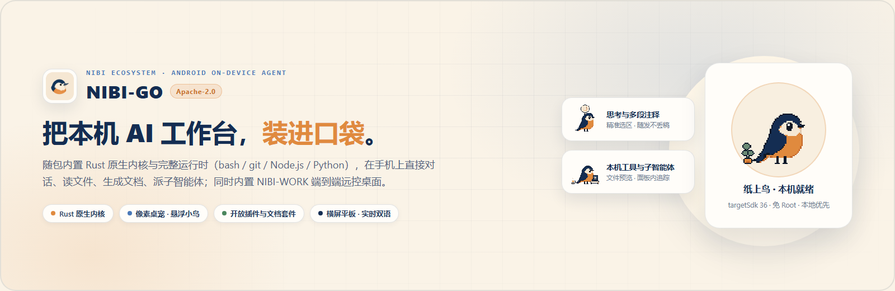
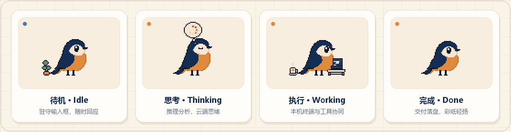
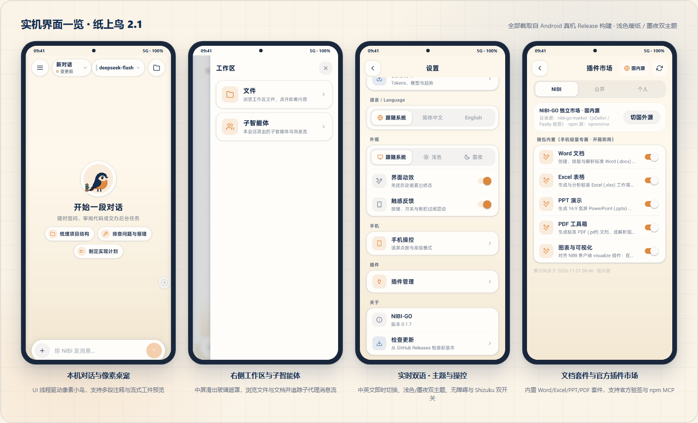
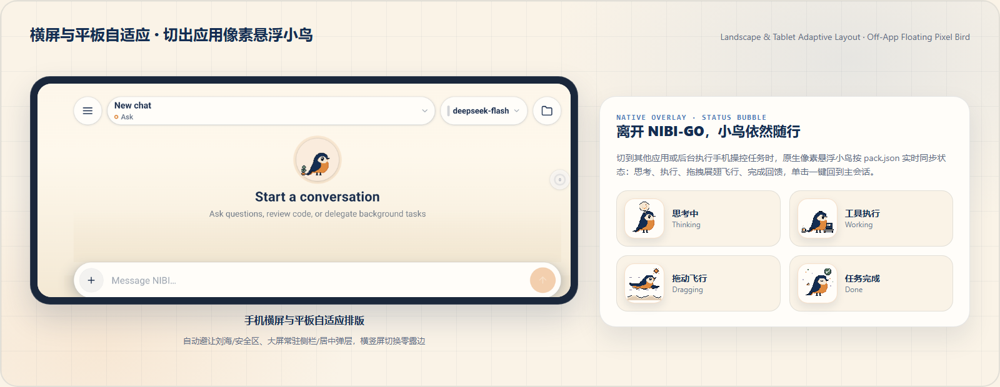

# NIBI-GO

<div align="center">
  

  <p>
    <strong>简体中文</strong> ·
    <a href="README.en.md">English</a> ·
    <a href="https://nibistudio.cn">官网下载</a> ·
    <a href="https://github.com/Ebonyhtx/nibi-go-market">官方插件市场</a> ·
    <a href="docs/README.md">架构与设计文档</a>
  </p>
</div>

**NIBI-GO** 是 NIBI 生态的 **Android 移动客户端**：把 Rust 原生内核、随包命令行运行时、文件工作区、子智能体、文档套件和可验证的插件生态装进一台手机，让你离开电脑也能直接推进真实工作。

- **NIBI-GO（默认主体）**：手机本机 AI Agent 工作台，免 Root、免 PRoot、本地优先；拥有独立于桌面端的移动端插件体系。
- **NIBI-WORK（内置远控入口）**：从 GO 侧栏一键进入，通过 Relay V2 端到端加密通道连接桌面端 [NIBI](https://github.com/Ebonyhtx/nibi-client)，随时查看长任务进度、回复提问与处理待审批操作。

---

## 纸上鸟陪伴 · 动态状态一目了然

应用内与切出应用后的全局悬浮小鸟共用同一套 `64×64` 像素真源图集（浅色暖纸 / 墨夜双套），在 UI 线程零重渲染驱动；思考、调用工具、搬运待发注释、拖动展翅飞行、完成任务各有专属动作，无需盯日志就能读懂 Agent 此刻在做什么。

<div align="center">
  
</div>

---

## 实机界面一览

<div align="center">
  
</div>

<br />

<div align="center">
  
</div>

---

## 核心能力

| 能力模块 | 你可以直接做什么 |
|---|---|
| **本机 Rust 内核与随包运行时** | 进程内运行自建 `libnibi.so`（targetSdk 36 免 Root），随包携带 `bash`、`busybox`、`git`、`Node.js`、`Python`、`ripgrep`、`jq`，可在本机工作区真实读写文件、检索与执行命令。 |
| **高可读消息流与可视化预览** | 流式 Markdown 排版、代码高亮、交互式 HTML / SVG 工件卡片与全屏预览；消息长按支持分段多选与自由裁剪注释，发送失败不丢稿。 |
| **右侧工作区与子智能体面板** | 屏幕中部跟手横滑呼出玻璃遮罩侧栏：浏览工作区文件树、原生无乱码预览 `docx / xlsx / pptx / pdf / md / html / 图片`，并在面板内以只读独立订阅实时查看子智能体消息流。 |
| **像素桌宠与离线悬浮小鸟** | 应用内 Skia 最近邻渲染、UI 线程帧驱动（后台与失焦自动停帧）；离开 NIBI-GO 或执行手机操控时，原生 `StatusBubble` 以同一像素小鸟随行桌面，拖动展翅、单击回前台。 |
| **文档套件与独立插件市场** | 随包内置 Word / Excel / PowerPoint / PDF 与图表可视化套件；接入独立签名市场 [nibi-go-market](https://github.com/Ebonyhtx/nibi-go-market)，支持标准 ZIP 插件与纯 JS npm MCP 服务器原生安装、环境变量自动检测及国内/国外双镜像源切换。 |
| **横屏、平板与实时双语** | 遵循 Material 3 窗口断点与安全区自适应（手机横屏、折叠屏与平板常驻侧栏/居中弹层）；设置页支持简体中文 / English 实时热切换与浅色暖纸 / 墨夜深色双主题。 |
| **NIBI-WORK 手机远控** | 扫码配对桌面端 NIBI，端到端加密同步会话、工具进度与审批请求；配合前台保活服务与系统通知，不错过长任务节点。 |
| **可选手机操控（双开关显式授权）** | 默认关闭；按需开启无障碍读屏点按（开关 1）与 Shizuku 高级模式（开关 2），敏感操作显式确认，权限边界清晰可控。 |

---

## 产品原则

- **本地优先**：会话记录、项目工作区、项目级记忆与模型配置默认留在设备本地；远控与云端登录均为显式动作。
- **过程可核查**：工具调用、文件改动、子智能体轨迹与文档产物都可直接打开回看，不把“模型说完成了”当成完成。
- **权限有边界**：Shell / 运行时、无障碍操控与第三方插件均为显式授权能力面；API Key 留在内核与系统安全存储，不透传给子进程环境。
- **可验证分发**：官方插件索引采用 Ed25519 签名，所有 ZIP 与 npm MCP 产物按 `sha256` / SRI 完整性校验，安装 APK 校验发布签名证书指纹。

---

## 插件生态与安全提示

官方插件市场位于独立公开仓 [nibi-go-market](https://github.com/Ebonyhtx/nibi-go-market)：客户端只接受官方 Ed25519 签名的索引，并按索引里的摘要校验每个插件包。第三方插件通过 Pull Request 提交，格式与安全审查标准见该仓 [CONTRIBUTING.md](https://github.com/Ebonyhtx/nibi-go-market/blob/main/CONTRIBUTING.md)。

> 插件是**会运行的代码**：安装第三方插件即在本机运行作者提供的程序。市场静态扫描与人工审查降低风险，但不等于绝对安全保证；请只安装你信任的来源。索引格式、验签与防回滚设计见 [`docs/design/market-index.md`](docs/design/market-index.md)。

---

## 开源范围与仓库结构

本仓库包含 NIBI-GO 全部可构建公开源码；发布签名密钥、运营侧服务与内部工程计划不在公开仓中（见 [SECURITY.md](SECURITY.md)）。

| 目录 | 职责 |
|---|---|
| `app/` | Expo SDK 58 / React Native 0.88 应用（`src/app/` 为 expo-router 路由，`src/i18n/` 为实时双语层） |
| `app/modules/kernel-host` | 内核宿主：Expo 原生模块、C JNI 薄层与 `:kernel` 独立进程 Service |
| `app/modules/nibi-phone` | 手机能力原生模块：像素宠物悬浮气泡（`StatusBubble.kt`）、无障碍桥与 Shizuku 适配 |
| `app/modules/nibi-keepalive` | 前台保活服务（保障后台长任务与远控连接不被系统查杀） |
| `app/modules/nibi-updater` | 应用内更新安装器（FileProvider + PackageInstaller + SHA-256 校验） |
| `kernel/` | Android 内核独立维护 fork（Rust workspace，构建 16 KB 对齐的 `libnibi.so` 与 `nibi-rs`） |
| `packages/kernel-session` | 本机内核会话客户端：快照/增量投影、只读子会话订阅、工具行派生 |
| `packages/relay-client` | Relay V2 远控客户端：状态机、扫码配对、E2E 加密信封 |
| `packages/chat-core` | 聊天状态机：V4 reducer、replay/gap 对账、审批状态机（纯 TS、无 RN 依赖） |
| `packages/shared-extract` | 抽取自 [nibi-client](https://github.com/Ebonyhtx/nibi-client) 的协议契约（来源见 [NOTICE.md](NOTICE.md)） |
| `packages/phone-tools` | 跨平台手机工具面接口契约 |
| `packages/market-index`、`packages/plugin-contract`、`packages/plugin-license` | 插件清单契约、Ed25519 索引验签与设备授权纯 TS 库 |
| `docs/` | 架构决策台账（D1–D25）与公开设计规格（入口 [docs/README.md](docs/README.md)） |
| `scripts/` | 架构边界门禁、公开仓脱敏/元数据门禁、内核与运行时构建脚本 |

---

## 从源码构建与验证

### 环境要求

- Node.js **24.22.2**、pnpm **10.33.2**、Git（版本固定于 [mise.toml](mise.toml)）
- Android 开发另需 Android SDK、NDK 与 JDK 17；Windows 上的 CMake 短路径限制由 `app/plugins/withCmakeVersion.js` 与 [AGENTS.md](AGENTS.md) 说明处理

### 门禁与测试

```bash
pnpm install
pnpm -r typecheck                   # 全仓 TypeScript 类型检查
pnpm test                           # 全仓单测（纯 TS 层在 Node 可直接跑）
node scripts/check-boundaries.mjs   # 层间依赖白名单检查（协议层禁引入 RN/Expo）
node scripts/check-public-repo.mjs  # 公开仓安全与图片元数据脱敏检查
```

### 移动端开发

```bash
cd app
pnpm exec expo start          # 启动 Metro
pnpm exec expo run:android    # 构建并安装到连接设备 / 模拟器
```

### 可选环境变量

运行时环境变量示例见 [app/.env.example](app/.env.example)：

| 变量 | 用途 |
|---|---|
| `EXPO_PUBLIC_NIBI_GO_OIDC_CLIENT_ID` | NIBI 账号中心 OIDC native app client id（回调 `nibigo://login`） |
| `EXPO_PUBLIC_NIBI_ENDPOINT_ORIGIN` | 业务 / 中继端点 origin 覆盖（自建联调用） |
| `EXPO_PUBLIC_NIBI_RELAY_WS_URL` | Relay V2 WebSocket 入口覆盖 |
| `EXPO_PUBLIC_NIBI_RELEASE_REPO` | 应用内更新检查仓（`owner/repo`） |
| `NIBIGO_CXX_STAGING` / `NIBIGO_CMAKE_VERSION` | Windows 原生构建缓存目录 / CMake 版本覆盖 |

---

## 参与贡献与安全

- 提交 PR 前请阅读 [CONTRIBUTING.md](CONTRIBUTING.md) 并完整通过本地门禁。
- 安全漏洞请按 [SECURITY.md](SECURITY.md) 私下报告，不要开设公开 Issue。
- 行为准则见 [CODE_OF_CONDUCT.md](CODE_OF_CONDUCT.md)。
- 架构决策与设计规格入口见 [docs/README.md](docs/README.md)。

## 许可证与来源

本项目以 **[Apache License 2.0](LICENSE)** 发布。协议契约抽取自 [nibi-client](https://github.com/Ebonyhtx/nibi-client)（Apache-2.0）；上游沿革与第三方声明见 [NOTICE.md](NOTICE.md)、[LICENSING.md](LICENSING.md) 与 [THIRD-PARTY-NOTICES.md](THIRD-PARTY-NOTICES.md)；品牌名称与标识使用规则见 [TRADEMARKS.md](TRADEMARKS.md)。
